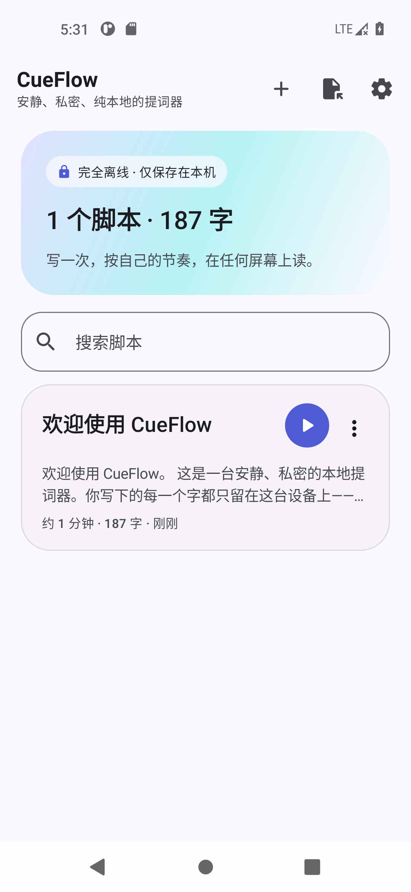
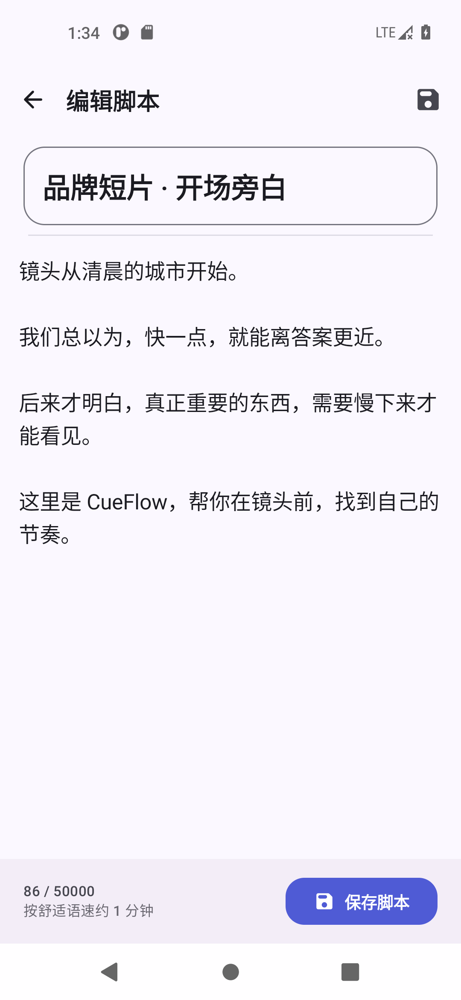
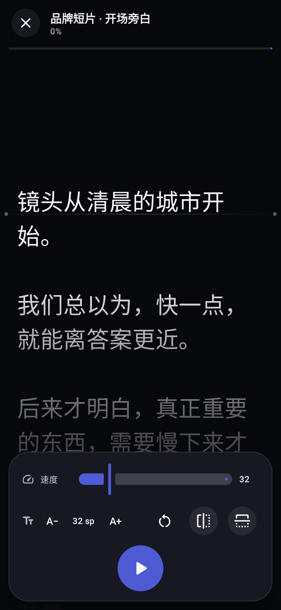
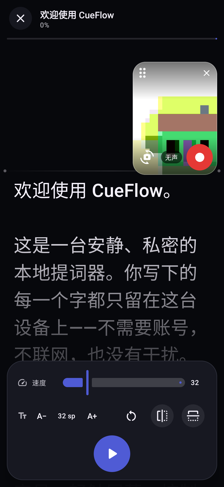
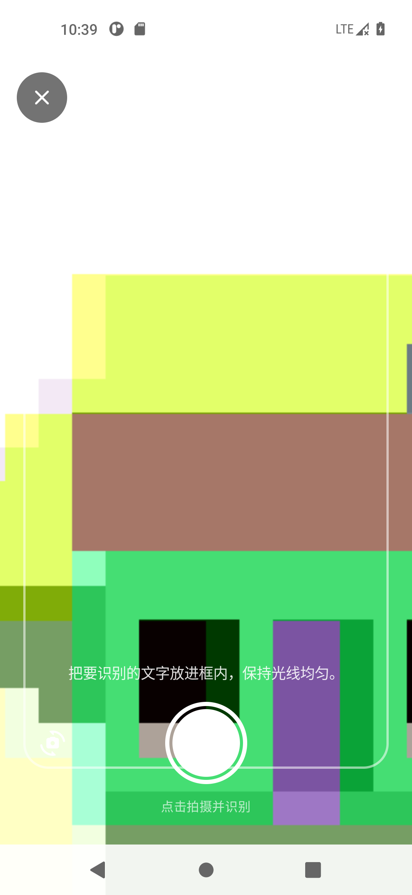
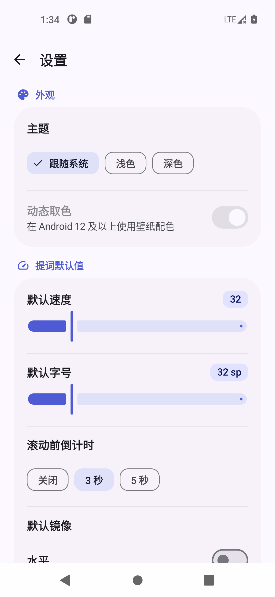
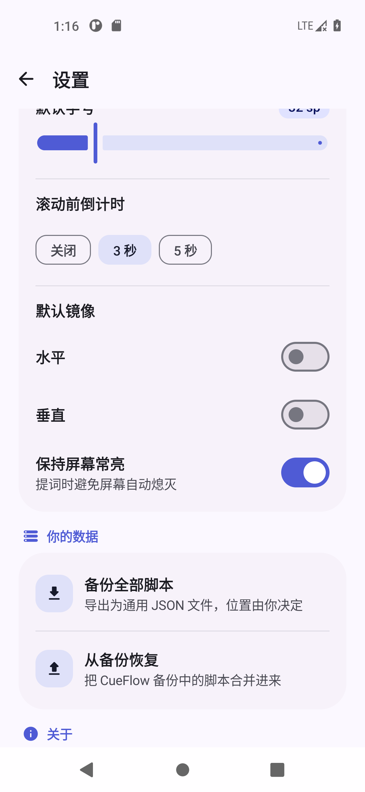

# CueFlow 提词器

> 一台安静、私密、纯本地的 Android 提词器。Material 3 界面，低内存占用，适合日常拍摄、直播、演讲和网课。

CueFlow 是一个完全离线的开源 Android 提词器。没有账号、没有广告、没有统计 SDK，也没有网络权限。脚本保存在应用私有目录，只有你能打开。相机和麦克风只在你主动开始录制时使用。

## 功能

- **现代 Material 3 界面**：Android 12+ 动态取色、边到边显示、深色模式、26–36dp 大圆角、无障碍触控尺寸。
- **流畅全屏提词**：逐帧滚动，速度 10–120 dp/s 实时可调；字号 24–64 sp；行高 1.5 倍；横向 / 纵向镜像；阅读辅助线；进度条。
- **为拍摄而设计**：3 / 5 秒倒计时、屏幕常亮、沉浸式全屏、控制栏自动隐藏、轻触唤回。
- **本地相机录制**：提词时打开前置/后置摄像头小窗，边看提词边录制带声音的 MP4；预览窗可拖动，未开始录制时也能隐藏，隐藏后仍可用红点按钮直接开始录制；录制中隐藏则只保留顶部小红点提示，录制不中断。
- **导入文档**：支持 `.docx`、`.doc`、`.pdf`、`.txt`、`.md` / `.markdown`、`.html` / `.htm` / `.xhtml`、`.rtf`、`.odt`、`.epub`、`.csv`，在本地提取文字并生成一条新脚本。
- **离线 OCR（PP-OCRv6 small）**：支持 `.png`、`.jpg` / `.jpeg`、`.webp`、`.bmp` 图片；扫描版 PDF 没有文字层时自动逐页 OCR。检测 + 识别模型约 34 MB，纯本地 TensorFlow Lite CPU 推理，不上传图片、不联网。
- **拍照识别**：首页新增【拍照识别】入口，打开复用 CameraX 的相机预览，拍照后直接走同一套离线 OCR，自动处理 EXIF 方向；拍照与视频录制不会同时抢占相机。
- **录制文件**：Android 10+ 直接保存到相册 `Movies/CueFlow`（不申请存储权限）；Android 7–9 保存到应用文件并可一键分享到相册/网盘/剪辑软件。
- **本地脚本库**：新建、编辑、搜索、复制、删除；输入后 800ms 自动保存，按返回键也会保存。
- **可靠的数据层**：UTF-8 JSON + `AtomicFile` 原子写入；写入失败自动回退；损坏文件会保留为 `scripts-corrupt-*.json` 而不是被悄悄删除。
- **迁移与备份**：单篇导出 `.txt`；全部脚本导出为 JSON；恢复时按 ID 和时间戳合并，不会用旧备份覆盖新编辑。
- **隐私优先**：Manifest 中没有 `INTERNET` 权限，没有第三方分析或广告依赖，关闭系统云备份；相机/麦克风权限只用于本地录制。
- **低内存**：提词本身仍是轻量 UI；OCR 模型仅在导入图片/扫描件时按需加载并在完成后释放。Android 11 模拟器实测普通提词 Release PSS 约 **36 MB**，8 GB 手机运行 OCR 也有充足余量。

## 支持导入的格式

| 类别 | 扩展名 | 说明 |
| --- | --- | --- |
| Word | `.docx`、`.doc` | DOC 支持常见 Word 97–2003 复合文档；加密文件请先解密 |
| PDF | `.pdf` | 文字型优先直接提取；扫描版自动 OCR |
| 图片 | `.png`、`.jpg` / `.jpeg`、`.webp`、`.bmp` | PP-OCRv6 small 离线 OCR，支持中英日等 50 种语言 |
| 纯文本 | `.txt`、`.md`、`.markdown`、`.csv` | UTF-8 / UTF-16 / GB18030 自动识别 |
| 网页 | `.html`、`.htm`、`.xhtml` | 自动去除标签，保留段落 |
| 富文本 | `.rtf` | 提取正文，忽略字体/颜色等控制字 |
| 办公文档 | `.odt` | 读取 OpenDocument 正文 |
| 电子书 | `.epub` | 合并章节 XHTML 文本 |

所有解析和 OCR 都在设备本地完成，不上传原文件，不需要网络权限。

## 截图

| 首页 | 编辑 |
| --- | --- |
|  |  |

| 全屏提词 | 提词 + 录制 |
| --- | --- |
|  |  |

| 拍照识别 |
| --- |
|  |

| 设置 | 数据与备份 |
| --- | --- |
|  |  |

## 安装

### 直接安装 APK

**从 GitHub Releases 下载：**

https://github.com/ToolsMaker292/CueFlow/releases/latest

仓库内也保留安装包：

- `releases/CueFlow-1.1.2.apk`（最新正式签名版，含拍照识别）
- `releases/CueFlow-1.1.1.apk`、`CueFlow-1.1.0.apk`、`CueFlow-1.0.2.apk`、`CueFlow-1.0.1.apk`、`CueFlow-1.0.0.apk`（旧版本，保留用于回退）
- `app/build/outputs/apk/debug/app-debug.apk`（调试签名，适合开发调试）
- `app/build/outputs/apk/release/app-release.apk`（AGP 输出目录）

```bash
adb install -r releases/CueFlow-1.1.2.apk
```

也可以把 APK 传到手机后直接点击安装。系统要求 Android 7.0（API 24）或更高。

### 从源码构建

环境：

- JDK 17 或 21
- Android SDK Platform 35、Build-Tools 35.0.0
- Gradle 8.9（仓库自带 Wrapper）

```bash
git clone <your-fork-url> CueFlow
cd CueFlow
./gradlew :app:assembleDebug
```

Windows：

```bat
gradlew.bat :app:assembleDebug
```

正式包需要自己的签名。在项目根目录创建 `keystore.properties`（已在 `.gitignore` 中）：

```properties
storeFile=release/cueflow-release.jks
storePassword=***
keyAlias=cueflow
keyPassword=***
```

然后：

```bash
./gradlew :app:assembleRelease
```

> 发布到应用商店前，请替换为自己的签名密钥，并妥善离线保存。仓库和示例 APK 不包含可用于生产分发的私钥。

## 使用

1. 首页点击右下角 **+** 新建脚本。
2. 输入标题和正文，点击 **保存脚本**。离开页面时也会自动保存。
3. 在脚本卡片上点击播放按钮，进入全屏提词。
4. 点击播放后按倒计时开始；上下滑动可手动寻找位置，播放中仍可继续滚动。
5. 轻触屏幕唤出控制栏：速度、字号、重播、水平/纵向镜像、播放/暂停。
6. 在设置中调整默认速度、字号、倒计时、镜像和屏幕常亮。

### 提词器玻璃

如果使用 beam-splitter 提词器玻璃，打开 **水平镜像**，或到设置中把它设为默认。纵向镜像用于倒装支架 / 特殊反射设备。

## 数据与隐私

- 脚本位置：`/data/data/com.cueflow.app/files/scripts.json`（Debug 包为 `com.cueflow.app.debug`）。
- 设置位置：应用私有的 `SharedPreferences`。
- 录制视频：Android 10+ 写入系统相册的 `Movies/CueFlow`；旧版 Android 写入应用外部文件目录，并通过系统分享导出。
- 备份是明文的 JSON / TXT 文件，由你选择保存位置；请自行注意敏感内容。
- 应用不申请网络权限，因此不存在“偷偷上传”的可能。
- 相机/麦克风权限只在点击录制按钮时请求；录制文件不会离开设备，除非你自己点击分享。
- 导入的 Word 文件只在本地读取，解析结果写入本机脚本库，不会上传。
- 详见 [PRIVACY.md](PRIVACY.md)。

## 工程结构

```text
app/src/main/java/com/cueflow/app/
├── MainActivity.kt              # 单 Activity、边到边、Splash
├── MainViewModel.kt             # 页面状态、草稿、导入导出
├── data/
│   ├── Script.kt                # 数据模型与限制
│   ├── ScriptCodec.kt           # 纯函数编解码、校验、合并规则
│   ├── ScriptRepository.kt      # AtomicFile 本地仓库
│   ├── SettingsRepository.kt    # SharedPreferences 设置
│   ├── ReadingTime.kt           # 中英混排语速估算
│   ├── DocumentImporter.kt      # TXT/MD/HTML/RTF/ODT/EPUB/CSV + 格式分派
│   ├── WordImporter.kt          # 本地 .docx 段落提取（SAX + ZIP）
│   ├── DocTextExtractor.kt      # 旧版 .doc 的 OLE2 复合文档/片段表提取
│   ├── PdfTextExtractor.kt      # 本地 PDF 文本流与 ToUnicode 映射
│   └── ocr/                     # PP-OCRv6 small TFLite 推理、图片/PDF OCR
└── ui/
    ├── CueFlowApp.kt            # Navigation Compose 路由
    ├── HomeScreen.kt            # 脚本库 / 搜索 / 菜单
    ├── EditorScreen.kt          # 编辑与自动保存
    ├── PromptScreen.kt          # 全屏提词、倒计时、镜像
    ├── CameraPreviewCard.kt     # 可拖动/隐藏的本地相机录制小窗
    ├── PhotoOcrScreen.kt        # 独立拍照识别入口
    ├── camera/CameraRuntime.kt  # 拍照/录像共用 CameraX provider 与会话
    ├── SettingsScreen.kt        # 设置、备份、关于
    └── theme/                   # Material 3 色彩、字体、形状
```

技术栈：Kotlin 2.0、Jetpack Compose、Material 3、Navigation Compose、kotlinx.serialization、Coroutines。`minSdk 24`，`targetSdk 35`，`compileSdk 35`。

## 测试

```bash
# 纯 JVM 单元测试（编解码、语速、设置归一化）
./gradlew :app:testDebugUnitTest

# 设备 / 模拟器测试（UI 冒烟 + 原子写入 + 损坏恢复 + 备份合并）
./gradlew :app:connectedDebugAndroidTest
```

本项目在 Android 11（API 30，x86_64）模拟器上完成：

- 29 个 JVM 单元测试通过（含 10 种文档格式、GB18030 文本、PDF Flate 流、OLE2 DOC、恶意 XML/空文档解析）；9 个设备端测试通过（UI 冒烟、原子持久化、损坏恢复、备份合并、DOCX/TXT 导入、3 项 PP-OCRv6 small 实际识别）；【拍照识别】入口、CameraX 预览、拍照→OCR→生成脚本已在 Android 11 模拟器实际验证。
- `lintDebug` **0 errors / 0 warnings**（含 CameraX 录音权限检查）。
- Debug / Release APK 安装与启动；R8 正式包序列化读写正常。
- 新建 → 自动保存 → 返回首页 → 全屏提词；倒计时、自动滚动、控制栏自动隐藏。
- 中文 / 英文界面、深色模式、状态栏图标适配。
- Android 11 模拟器实拍：相机预览、录制 720p MP4、停止并保存到 `Movies/CueFlow` 全流程通过。
- Android 11 模拟器：从系统文件选择器导入 `.docx`，生成新脚本并通过设备端测试。
- Release PSS 约 36 MB；Manifest 无 `INTERNET` 权限；APK 签名校验通过。

## 兼容性

- 最低 Android 7.0（API 24）。
- 已在 Android 11（API 30）上运行验证；工程同时配置了 Android 15（API 35）的 AVD，可在正常硬件加速的机器上使用。
- 没有原生 ABI 依赖，不区分 ARM / x86；一份 APK 覆盖所有常见手机。
- 建议 2 GB 以上内存；4 GB 手机完全足够。

## 参与贡献

欢迎提交 Issue 和 PR。请先阅读 [CONTRIBUTING.md](CONTRIBUTING.md)。所有改动都必须保持：

1. 不新增网络权限或远程依赖；
2. 不引入账号、分析 SDK 或广告；
3. 通过单元测试与 lint；
4. 不破坏低内存设备上的启动与提词体验。

## 许可证

Apache License 2.0，见 [LICENSE](LICENSE)。第三方依赖许可见 [THIRD_PARTY_NOTICES.md](THIRD_PARTY_NOTICES.md)。

---

## English

CueFlow is a local-first, open-source Android teleprompter built with Kotlin and Jetpack Compose Material 3.

- Smooth frame-based auto-scroll, adjustable speed and text size, countdown, horizontal/vertical mirror, reading guide, immersive mode and keep-screen-on.
- Local script library with autosave, search, duplicate, delete, TXT export and JSON backup/restore.
- No `INTERNET` permission, no analytics, no account, no ads.
- Optional local camera recording (front/back) with sound, saved as MP4; camera/mic only while recording.
- Local `.docx` import; no Office library, no upload.
- `minSdk 24`, `targetSdk 35`. Release PSS measured at ~36 MB on an Android 11 emulator.
- Build: `./gradlew :app:assembleDebug`; tests: `./gradlew :app:testDebugUnitTest`.

Licensed under Apache-2.0.
